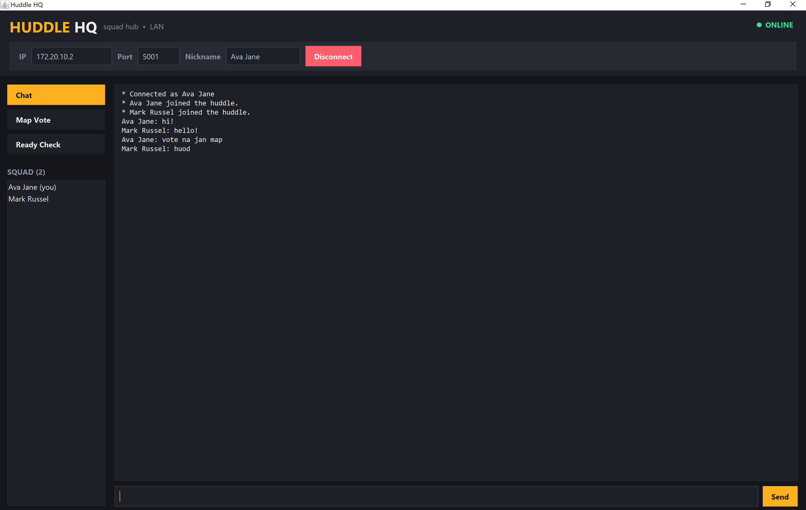
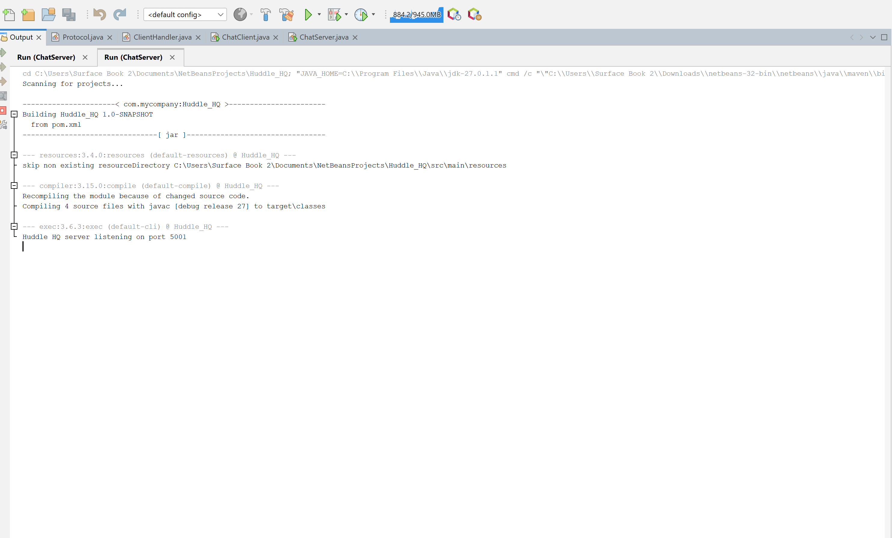
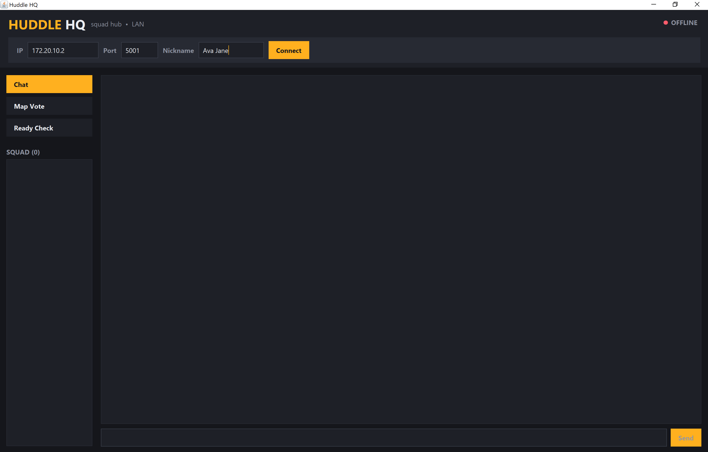
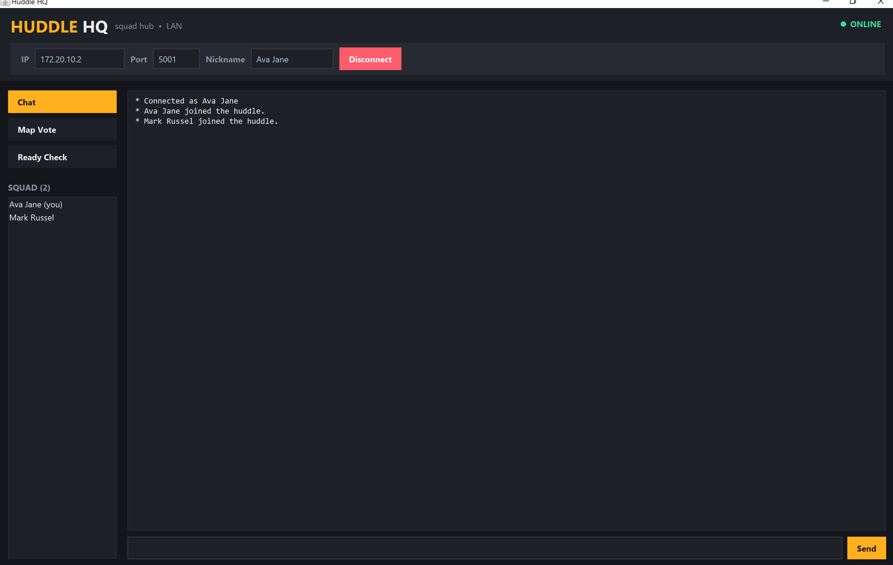
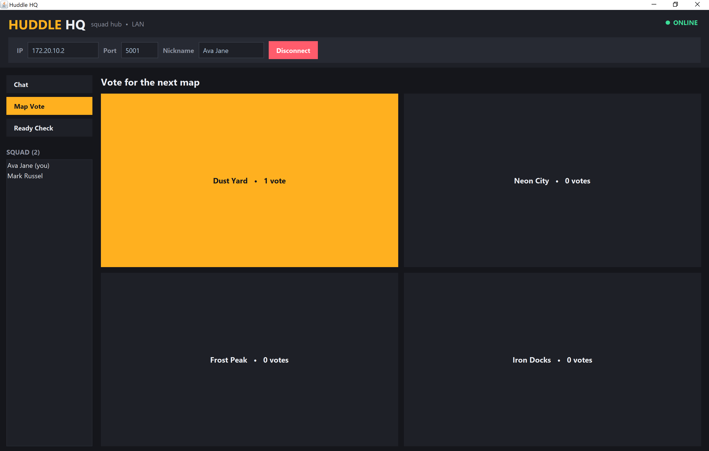
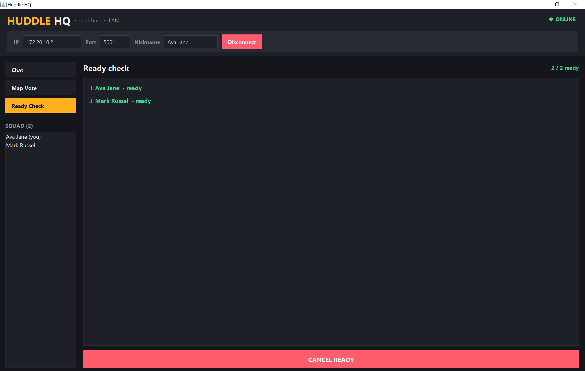
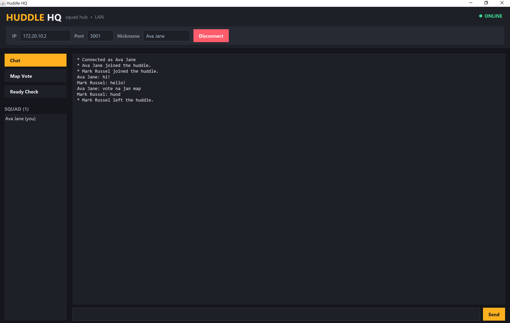
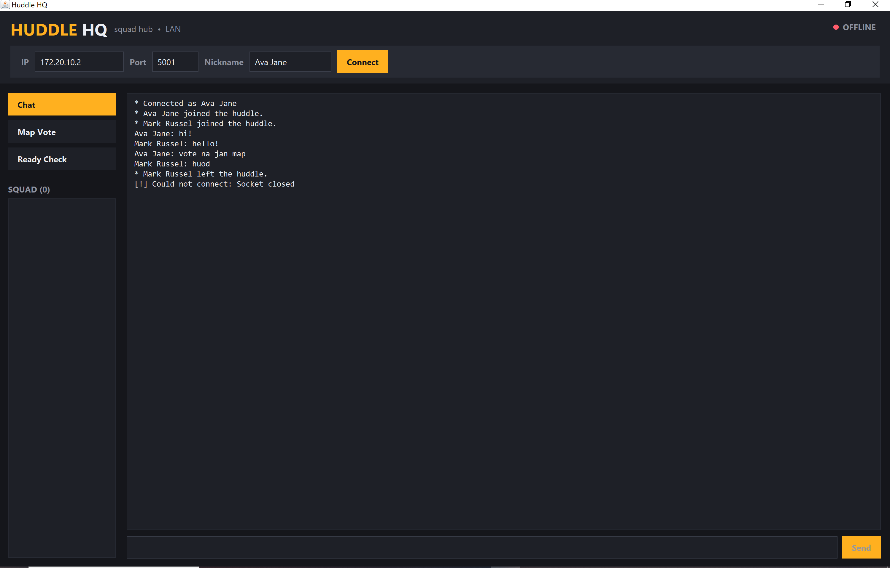

# Huddle HQ - Squad Hub (Java LAN Chat)

**Course:** ITAS1 - Network Programming - BSIT 2B-SD | **School:** Iloilo State University of Fisheries Science and Technology (ISUFST) | **Instructor:** Kenth Joshua Espina

**Repository:** ITAS-1-2B SD-Espinosa-Fernandez
**Submission and presentation:** November 23-27, 2026

> School project. The interface, map names, and theme are original designs made for this course; no game art, icons, or third-party assets are used.

Huddle HQ is a Java LAN chat for gaming squads who need a quick "huddle" before a match: one place to chat, vote on a map, and check that everyone is ready. It uses Java sockets (TCP), a Swing GUI, and in-memory state.



*Huddle HQ running on the LAN: the Chat, Map Vote, and Ready Check tabs and the squad list on the left, the live group chat on the right.*

---

## Table of Contents

1. [Members](#members)
2. [Project Overview](#project-overview)
3. [Concept Proposal and Approval](#concept-proposal-and-approval)
4. [User Problem and Theme](#user-problem-and-theme)
5. [Core Features](#core-features)
6. [Original Theme Features](#original-theme-features)
   - [Feature 1: Map Vote](#feature-1-map-vote)
   - [Feature 2: Ready Check](#feature-2-ready-check)
7. [Commands and Controls](#commands-and-controls)
8. [Architecture](#architecture)
9. [Message Format](#message-format)
10. [Setup Instructions](#setup-instructions)
    - [Requirements](#requirements)
    - [Run with NetBeans](#run-with-netbeans)
    - [Run from the Command Line](#run-from-the-command-line)
    - [LAN Demonstration](#lan-demonstration)
    - [Troubleshooting](#troubleshooting)
11. [Screenshots](#screenshots)
12. [Test Results](#test-results)
13. [Known Issues](#known-issues)
14. [Division of Responsibilities](#division-of-responsibilities)

---

## Members

| Name                  | GitHub                                                   | Email                      | Role             |
| --------------------- | -------------------------------------------------------- | -------------------------- | ---------------- |
| Ava Jane Espinosa     | [espinosaavajaneb](https://github.com/espinosaavajaneb) | espinosaavajaneb@gmail.com | Project Creator  |
| Mark Russel Fernandez |                                     |           | Project Operator |

**Course and section:** ITAS1 - BSIT 2B-SD

[Back to top](#table-of-contents)

---

## Project Overview

**Huddle HQ** works as a squad hub for players on the same LAN or Wi-Fi. One computer runs the server; any number of clients connect by typing the server IP, port, and a nickname, then chat and use the squad tools together.

Built with:

- Java `ServerSocket` / `Socket` (TCP) with UTF-8 text streams
- a multi-client server that runs **one thread per connected client**
- a simple line-based text protocol shared by client and server (`Protocol.java`)
- a dark-themed **Swing** desktop GUI with an amber accent color
- in-memory shared state (no database, no accounts)
- a Maven project built and run in Apache NetBeans

### Project Structure

```
Huddle_HQ/
├── docs/                      screenshots used in this README
├── src/main/java/
│   ├── ChatServer.java        accept loop, shared state, broadcasts
│   ├── ClientHandler.java     one thread per connected client
│   ├── ChatClient.java        Swing window and networking
│   └── Protocol.java          message commands, separator, maps, helpers
├── pom.xml                    Maven build configuration
└── README.md
```

[Back to top](#table-of-contents)

---

## Concept Proposal and Approval

| Item                    | Details                                                                                                         |
| ----------------------- | --------------------------------------------------------------------------------------------------------------- |
| **Theme**               | Esports Team Room - squad hub                                                                                   |
| **Audience**            | Gaming squads who plan a match together over the same LAN or Wi-Fi                                              |
| **Problem**             | In an ordinary group chat, deciding on a map and confirming that everyone is ready gets messy and easy to miss. |
| **Feature 1**           | **Map Vote** - each player votes for one of four maps; live vote counts are shared with the whole squad.        |
| **Feature 2**           | **Ready Check** - each player toggles Ready; everyone sees who is ready and an "X / Y ready" counter.           |
| **Sample screens**      | See [Screenshots](#screenshots)                                                                                 |
| **Instructor approval** | Kenth Joshua Espina, 11-27-2026                                                                                 |

[Back to top](#table-of-contents)

---

## User Problem and Theme

Squad coordination before a match needs to be fast and clear. Plain text chat cannot easily collect votes or show at a glance who is ready. In our own test chat, the map question came up as a normal message ("vote na jan map"), which is exactly the kind of thing that gets lost in a busy chat.

Huddle HQ goes beyond ordinary messaging by turning those needs into shared state that the server keeps and sends to every connected client:

- the **squad list** always shows who is currently in the huddle;
- **Map Vote** lets the squad decide on a map together;
- **Ready Check** shows whether everyone is ready.

The dark theme and amber highlights are original to this project.

[Back to top](#table-of-contents)

---

## Core Features

- Configurable server **IP and port** in the GUI (the fields lock while connected)
- **Nickname** entry on connect; pressing Enter in the Nickname field also connects
- Nickname rules checked by the server: not empty, at most **16 characters**, and **unique**. The characters `|`, `,` and `:` are removed because the protocol uses them as separators.
- **Group chat**: messages go to everyone in the huddle, shown as `Nickname: message`. Send with the **Send** button or the Enter key; empty messages are ignored.
- **Squad list** with a live member count, e.g. **SQUAD (2)**, sorted by name, with **(you)** marking your own entry
- System notices in the chat, marked with `*`: `* Connected as ...`, `* ... joined the huddle.`, `* ... left the huddle.`
- Errors in the chat, marked with `[!]` (for example a bad port, a missing nickname, or a failed connection)
- Connection status indicator: red **OFFLINE** / green **ONLINE**, and a **Connect** button that turns into a red **Disconnect** button
- Tabbed layout in the sidebar: **Chat**, **Map Vote**, **Ready Check** (the active tab is highlighted in amber)

[Back to top](#table-of-contents)

---

## Original Theme Features

### Feature 1: Map Vote

The **Map Vote** tab ("Vote for the next map") shows four original maps as large buttons in a 2 x 2 grid:

| Dust Yard      | Neon City      |
| -------------- | -------------- |
| **Frost Peak** | **Iron Docks** |

- A player clicks a map to vote for it. Each player has **one vote**; clicking another map moves the vote.
- The server stores the votes (`nickname -> map`), counts them, and sends the totals to **every** client, so all buttons show live counts such as `Dust Yard • 1 vote` and `Neon City • 0 votes`.
- The map **you** voted for is highlighted in amber on your own screen.
- When a player leaves, their vote is removed and the counts update for everyone.

### Feature 2: Ready Check

The **Ready Check** tab lists every squad member with their status:

- `✔ Name - ready` in green, or `• Name - waiting` in grey
- a summary at the top right, e.g. **2 / 2 ready**, which turns **green when the whole squad is ready**
- a big button at the bottom: green **I'M READY**, which becomes a red **CANCEL READY** after you click it

The server keeps the set of ready players and sends the list to every client whenever someone readies up, cancels, joins, or leaves. A player who leaves is removed from the ready list.

[Back to top](#table-of-contents)

---

## Commands and Controls

| Action                | How to do it                                       | What the client sends   |
| --------------------- | -------------------------------------------------- | ----------------------- |
| Join the huddle       | Enter IP, port, and nickname, then click **Connect** (or press Enter in Nickname) | `JOIN\|nickname`        |
| Send a chat message   | Type in the message box, then click **Send** or press Enter | `CHAT\|text`            |
| Vote for a map        | Open **Map Vote** and click a map                  | `VOTE\|map`             |
| Ready / cancel ready  | Open **Ready Check** and click **I'M READY** / **CANCEL READY** | `READY\|1` / `READY\|0` |
| Leave the huddle      | Click **Disconnect** or close the window           | (socket closes)         |

[Back to top](#table-of-contents)

---

## Architecture

```
 +--------------+   TCP   +---------------------------------+   TCP   +--------------+
 | ChatClient   |<------->| ChatServer                      |<------->| ChatClient   |
 | (Swing GUI)  |         |  accept loop (main thread)      |         | (Swing GUI)  |
 +--------------+         |  ClientHandler thread per client|         +--------------+
                          |  shared state:                  |
                          |   clients | votes | ready       |
                          +---------------------------------+
```

| File                 | Responsibility |
| -------------------- | -------------- |
| `ChatServer.java`    | Opens the `ServerSocket`, accepts clients in a loop and starts a `ClientHandler` thread for each. Holds the shared state (`clients`, `votes`, `ready`) in concurrent collections, broadcasts messages, and sends the squad list, vote counts, and ready list to everyone (`sendState`). |
| `ClientHandler.java` | One thread per client. Reads the first `JOIN` line and validates the nickname, then reads `CHAT`, `VOTE`, and `READY` lines and passes them to the server. On disconnect it removes the player and announces that they left. |
| `ChatClient.java`    | The Swing window: header with IP / Port / Nickname and Connect, sidebar with tabs and squad list, and the Chat, Map Vote, and Ready Check cards. Connects on a background thread and updates the GUI from incoming messages. |
| `Protocol.java`      | Shared constants and helpers: message commands, separator, default port, the list of maps, and `build` / `parse` / `cleanNick`. |

### Message Path

1. A player types a message and presses Enter; `ChatClient` sends `CHAT|text` over its socket.
2. That player's `ClientHandler` thread on the server reads the line and passes it to `ChatServer`.
3. `ChatServer` broadcasts `CHAT|nickname|text` to every connected client.
4. Each `ChatClient` receives the line on its background reader thread and updates the chat on the Swing thread.

### Concurrency and Reliability

- The server accepts many clients at the same time; each client is handled on its own thread.
- Shared state uses `ConcurrentHashMap` and a concurrent set, so several handler threads can update votes and ready status safely.
- The client connects and reads from the socket on a **background thread** with a 4-second connect timeout. Every GUI update is passed back to the Swing thread with `SwingUtilities.invokeLater`, so the window never freezes.
- When a client disconnects, its handler removes it from the squad, votes, and ready list; the server and the other clients keep running and their screens update.
- When a client goes offline, its window resets: the squad list, vote counts, and ready list are cleared.

[Back to top](#table-of-contents)

---

## Message Format

One message per line, fields separated by `|`.

| Direction        | Message                                | Meaning                       |
| ---------------- | -------------------------------------- | ----------------------------- |
| Client -> Server | `JOIN\|nickname`                       | First line after connecting   |
| Client -> Server | `CHAT\|text`                           | Send a chat message           |
| Client -> Server | `VOTE\|map`                            | Vote for a map                |
| Client -> Server | `READY\|1` or `READY\|0`               | Ready / cancel ready          |
| Server -> Client | `CHAT\|nickname\|text`                 | Chat message to show          |
| Server -> Client | `SYS\|text`                            | System notice (joined / left) |
| Server -> Client | `ERR\|text`                            | Error, e.g. nickname taken    |
| Server -> Client | `USERS\|Ava Jane,Mark Russel`          | Current squad list            |
| Server -> Client | `VOTES\|Dust Yard:1,Neon City:0,...`   | Vote counts per map           |
| Server -> Client | `READY_LIST\|Ava Jane:1,Mark Russel:0` | Ready status per player       |

[Back to top](#table-of-contents)

---

## Setup Instructions

### Requirements

| Item             | Value                                                          |
| ---------------- | -------------------------------------------------------------- |
| Java             | JDK 27 (the project compiles with `release 27`)                |
| IDE / build tool | Apache NetBeans with Maven (project `com.mycompany:Huddle_HQ`) |
| Dependencies     | None (standard Java library only)                              |
| Network          | All computers on the **same LAN / Wi-Fi**                      |
| Default port     | `5000` (can be changed; our demo used `5001`)                  |

### Run with NetBeans

1. Open the `Huddle_HQ` project in NetBeans.
2. Run **`ChatServer.java`** (right-click > Run File). The Output window shows the port:

   ```
   Huddle HQ server listening on port 5001
   ```

   With no arguments the server uses port `5000`. To use another port, pass it as a program argument (Project Properties > Run > Arguments, e.g. `5001`).
3. Run **`ChatClient.java`** once for each player.
4. In each client, enter the server computer's IP address, the **same port** the server printed, and a nickname, then click **Connect**.
5. The status at the top right changes to **ONLINE**, and the squad list shows everyone in the huddle.

### Run from the Command Line

```
mvn compile
java -cp target/classes ChatServer 5001     # port is optional (default 5000)
java -cp target/classes ChatClient          # run once per player
```

### LAN Demonstration

1. **Computer A:** start the server and note the port it prints.
2. **Computer A:** find its IP address (for example with `ipconfig` on Windows). In our demo the computers were on a phone hotspot and the server was `172.20.10.2`.
3. **Computer A and Computer B:** start the client, enter Computer A's IP and the same port, choose a nickname, and click **Connect**.

### Troubleshooting

| Problem                                              | Fix |
| ---------------------------------------------------- | --- |
| `[!] Could not connect: ...`                         | Make sure the server is running and the IP and port match what the server printed. |
| Works on `localhost` but not from another PC         | Allow Java through the Windows firewall (or open the port) on the server computer. |
| Both PCs seem on the same network but fail           | Avoid guest or school networks with client isolation; use a phone hotspot or a normal router. |
| "Address already in use" on the server               | Another server is still running on that port. Stop it, or start the server on another port and use that port in the client. |
| `[!] Nickname is empty, too long, or already taken.` | Pick a different nickname of 1-16 characters that nobody else is using. |
| `[!] Port must be a number.`                         | Type only digits in the Port field. |

[Back to top](#table-of-contents)

---

## Screenshots


**1. Server running (NetBeans Output).** Maven builds `Huddle_HQ` (4 source files) and the server prints that it is listening on port 5001.



**2. Client start screen.** Status is OFFLINE. The IP (`172.20.10.2`), Port (`5001`), and Nickname (`Ava Jane`) are filled in, the Chat, Map Vote, and Ready Check tabs are visible, and the squad list is empty: **SQUAD (0)**.



**3. Connected.** Status shows ONLINE and the button changes to Disconnect. The chat shows `* Connected as Ava Jane` and the join notices for Ava Jane and Mark Russel. The squad list shows **SQUAD (2)** with "Ava Jane (you)".



**4. Group chat.** Messages from both players appear with the sender's nickname.


**5. Map Vote.** Ava Jane voted for Dust Yard, which is highlighted in amber and shows `1 vote`; the other maps show `0 votes`.



**6. Ready Check.** Both players are ready, the counter shows **2 / 2 ready** in green, and the button reads **CANCEL READY**.



**7. A member leaves.** Mark Russel disconnects: `* Mark Russel left the huddle.` appears and the squad list drops to **SQUAD (1)**. Ava Jane's client stays connected.



**8. Disconnected.** Ava Jane clicks Disconnect: status returns to OFFLINE, the button changes back to Connect, Send is disabled, and the squad list is cleared to **SQUAD (0)**.



[Back to top](#table-of-contents)

---

## Test Results

| #  | Test                     | Steps                                         | Expected                                                         | Actual                                                                 | Status  |
| -- | ------------------------ | --------------------------------------------- | ---------------------------------------------------------------- | ---------------------------------------------------------------------- | ------- |
| 1  | Start server             | Run `ChatServer` with port 5001               | Server prints the listening port                                 | Screenshot 1: "Huddle HQ server listening on port 5001"                | PASS    |
| 2  | Connect to server        | Enter IP, port, nickname; click Connect       | Status shows ONLINE; nickname appears in squad with "(you)"      | Screenshot 3: ONLINE, "Ava Jane (you)" in the squad list               | PASS    |
| 3  | Join notices             | A second client connects                      | "joined the huddle" appears; squad count updates                 | Screenshot 3: Mark Russel joined, SQUAD (2)                            | PASS    |
| 4  | Group chat               | Send messages from two clients                | Messages reach everyone with the sender's nickname               | Screenshot 4: messages from Ava Jane and Mark Russel shown             | PASS    |
| 5  | Map Vote                 | Open Map Vote and click Dust Yard             | My vote is highlighted; count updates for the squad              | Screenshot 5: Dust Yard highlighted with 1 vote                        | PASS    |
| 6  | Ready Check              | Both players click I'M READY                  | Both shown as ready; counter shows 2 / 2 in green                | Screenshot 6: both ready, "2 / 2 ready", button shows CANCEL READY     | PASS    |
| 7  | Leave notice             | Second client disconnects                     | "left the huddle" appears; squad list shrinks; app keeps running | Screenshot 7: Mark Russel left, SQUAD (1), Ava Jane still ONLINE       | PASS    |
| 8  | Disconnect               | Click Disconnect                              | Status OFFLINE; squad, votes, and ready list cleared             | Screenshot 8: OFFLINE, SQUAD (0), Connect button back (see [Known Issues](#known-issues)) | PASS    |

[Back to top](#table-of-contents)

---

## Known Issues

- **Check mark shows as a box.** In the Ready Check list the `✔` symbol appears as an empty box on our Windows PCs (Screenshot 6) because the font does not include that character. The status text ("- ready") and color are still correct.
- **Disconnect message wording.** After clicking Disconnect, the chat shows `[!] Could not connect: Socket closed` (Screenshot 8). The disconnect itself works correctly; only the message is misleading.
- **No vote reset.** Votes stay until a player changes their vote or leaves; there is no "new round" button yet.

[Back to top](#table-of-contents)

---

## Division of Responsibilities

| Member                    | Responsibility | Description                           |
| ------------------------- | -------------- | ------------------------------------- |
| **Ava Jane Espinosa**     | Project Creator  | Designed the Huddle HQ concept and theme, and built the server, client GUI, message protocol, Map Vote, and Ready Check. |
| **Mark Russel Fernandez** | Project Operator | Ran and tested the app on the LAN, handled the server setup and demo, captured the screenshots, and recorded the test results. |

[Back to top](#table-of-contents)
